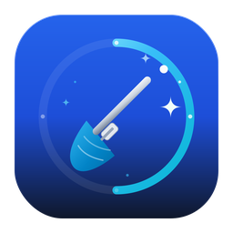

<p align="center">
  
</p>

<h1 align="center">Pristine</h1>

<p align="center">
  Reset browsers, find large files, remove unused apps and watch what your Mac is doing, all in one small app.
</p>

---

## Install

Open **Terminal** and run:

```bash
curl -fsSL https://raw.githubusercontent.com/PcMac24x7/pristine/main/install.sh | bash
```

That downloads the latest release, checks its checksum, and installs the app into `/Applications`. Then open it with:

```bash
open -a "Pristine"
```

Prefer to read a script before running it? Look at [`install.sh`](install.sh) first. It is short, and it only downloads from this repository's releases.

<details>
<summary><b>Other ways to install</b></summary>

**Homebrew**

```bash
brew install --cask pcmac24x7/tap/pristine
```

**A specific version**

```bash
curl -fsSL https://raw.githubusercontent.com/PcMac24x7/pristine/main/install.sh | bash -s -- --version 1.0.0
```

**Manually**

Download the `.zip` from the [Releases page](https://github.com/PcMac24x7/pristine/releases), unzip it, and drag the app into `/Applications`.

**Build from source**

```bash
git clone https://github.com/PcMac24x7/pristine.git
cd pristine
open *.xcodeproj
```

Then press Cmd+R in Xcode. You need Xcode 15 or later.

</details>

**Requirements:** macOS 14 (Sonoma) or newer, on Apple silicon or Intel.

## First launch: allow access to browser data

To clear Safari and other browsers' data, macOS requires you to give the app **Full Disk Access**:

1. Open **System Settings > Privacy & Security > Full Disk Access**.
2. Turn on **Pristine** (use the **+** button to add it if it isn't listed).
3. Quit and reopen the app. The badge in the top corner changes to **Access granted**.

## What it does

| | |
|---|---|
| **Browser reset** | Safari, Chrome, Edge, Brave, Arc and Firefox. Choose history, cookies, cache, site data and open tabs. Everything is moved to the Trash first, so it can be undone. |
| **Backups** | Save bookmarks, settings, logins and extensions before a reset, and restore them later. If a backup fails, nothing is deleted. |
| **Large files** | Scan your Mac for big files, review them, and move the ones you don't need to the Trash. Includes an Empty Trash button. |
| **Unused apps** | Lists apps you haven't opened in 3, 6 or 12 months, with their sizes. |
| **Activity Monitor** | Live CPU and memory use, grouped by app, with Quit and Force Quit. |
| **Disk space** | Used and free space on your Mac, always visible. |
| **Menu bar and schedule** | Quick actions from the menu bar, and optional scheduled resets that run in the background. |

## Safety and privacy

- Resets move files to the **Trash** rather than deleting them. **Empty Trash**, in the large files window, is permanent, and it asks first.
- The app runs entirely on your Mac. It has no accounts, no analytics, and makes no network requests of its own. The Donate button just opens PayPal in your browser.
- Browser sync (iCloud, Chrome, Firefox) can bring data back after a reset. Pause sync first if you want a clean slate.
- Always keep a copy of anything you can't afford to lose.

## Troubleshooting

**macOS says the app "can't be opened".** Clear the download flag and open it again:

```bash
xattr -dr com.apple.quarantine "/Applications/Pristine.app"
```

**It asks for Full Disk Access again after an update.** Releases that aren't notarized look like a new app to macOS each time. In Full Disk Access, remove the old entry with **-**, add the app again, and reopen it.

## Uninstall

```bash
curl -fsSL https://raw.githubusercontent.com/PcMac24x7/pristine/main/install.sh | bash -s -- --uninstall
```

Backups the app made stay in `~/Documents/Pristine Backups`, so you can keep or delete them yourself.

## Support the project

If this app saved you time, you can say thanks with a small tip. It's completely optional.

<p>
  
  &nbsp;<b>Made by PcMac.</b><br>
  &nbsp;<a href="https://paypal.me/pcmac24x7">paypal.me/pcmac24x7</a>
</p>
<br clear="left">

## License

[MIT](LICENSE). Not affiliated with or endorsed by Apple, Google, Microsoft, Mozilla, Brave, or The Browser Company. All product names are trademarks of their respective owners.
